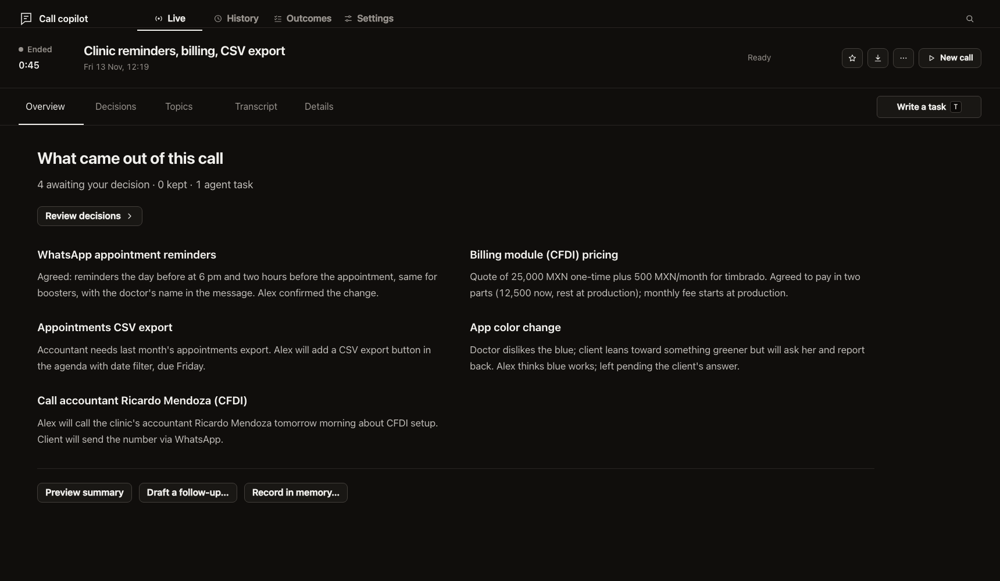

<p align="center">
  
</p>

# Yap

**Turn a conversation into work in progress.**

Yap is a Mac menu bar app for two moments: when you want to speak instead of type, and when a client call turns into something you need to do.

Tap right ⌘ to dictate into any app. Start **Call Copilot** to transcribe both sides of a call, follow the discussion, and turn agreements into tasks you can approve while you keep talking.

> **Client:** “Send the reminder at 6 pm the day before, and two hours before the appointment.”
>
> **Yap:** “Change WhatsApp reminders to day-before 6 pm and 2 hours before?”
>
> **You:** Press **Y**. A coding agent starts with the instructions and relevant call context. Keep talking. Come back to its result in the call record.

That last step is real work: approving an agent task starts a T3 Code agent with access to its configured workspace. Keeping a decision or a personal to-do saves a record instead.

<p align="center">
  
</p>

*The record after a scripted clinic call. Overview, decisions, topics and transcript are separate views.*

[What’s new](CHANGELOG.md) · [Install](#install) · [Your first call](#your-first-call) · [What the buttons do](#what-the-buttons-do) · [Update](#update-yap) · [Troubleshooting](#troubleshooting) · [Development and checks](#development-and-checks)

## What you can do

| In the moment | Afterward |
| --- | --- |
| Dictate wherever your cursor is | Find and reuse a previous dictation |
| Follow a call in mixed Spanish and English | Search across calls for a name, promise or agreement |
| Take or skip a decision with one key | Restore skipped decisions and approve work later |
| Start a task with **T**, using the call as context | Read agent results and reply to the agent |
| Correct a transcript line or turn it into a task | Export the record, draft a follow-up, or record it in memory |

Dictation runs locally with no Yap account or usage-minute limit. Call Copilot's default analysis and agent work use separately configured AI tools and may incur their usage costs. The current installation is from source; there is no automatic updater.

## Install

You need an **Apple Silicon Mac**, Homebrew, and the Xcode Command Line Tools. Capturing the other side of a call requires **macOS 14.2 or newer**.

1. Install [Homebrew](https://brew.sh) if needed. Install Apple's command line tools with `xcode-select --install` if they are missing.
2. In Terminal:

   ```sh
   git clone https://github.com/dertuman/yap
   cd yap
   ./install.sh
   ```

   This installs `whisper-cpp` if needed, downloads the speech model (about 574 MB, once), builds Yap, copies it into Applications, and opens it.
3. Allow **Microphone** and **Accessibility** in System Settings → Privacy & Security.
4. Put your cursor in a text field. Tap right ⌘, say a sentence, then tap again. Your words should appear at the cursor.

### Enable Call Copilot

Dictation works without the following tools. Call Copilot additionally needs:

- **Node.js**, installed with `brew install node`.
- **Claude Code CLI**, installed and authenticated for call analysis. Check that `claude --version` works, then complete its sign-in flow if necessary.
- **[T3 Code](https://t3.codes)**, running with a working agent provider, for approved tasks, follow-up drafts and memory recording.
- A T3 project whose workspace matches the copilot's workspace root, `~/Documents/GitHub` by default.

From the Yap checkout, connect T3 once:

```sh
node callpilot/setup-t3.mjs
```

The setup script expects `/Applications/T3 Code (Alpha).app`. If yours is elsewhere:

```sh
T3_APP="/Applications/Your T3 App.app" node callpilot/setup-t3.mjs
```

It stores a local authentication token in `~/.config/yap/t3-token`. Do not share that file.

Open Yap's **Start Call Copilot** menu item. Grant **System Audio Recording** when macOS asks. Keep Yap open while using the browser command center: the browser is the interface, and the Mac app captures the audio.

**Before your first test, open Settings and turn off “Recap when a call ends” if you do not want a memory-writing agent to run automatically.** It is enabled by default. Memory recording currently expects the workspace's `scripts/mem` workflow; it is not a general-purpose integration with every notes app.

## Your first call

1. **Start the call.** Use Yap's menu or the command center's **New call** button. Both sides should appear in Transcript after speech is processed.
2. **Keep the Live call view beside your meeting.** It shows the current topic and compact decision cards. Each card explains what accepting does, with a one-click accept or skip. New cards append; answered cards stay in place.
3. **Review the kind of decision.** An agent task starts work; a decision records an agreement; a to-do records something for you to do yourself. Open its details if you need context.
4. **Press Y to take it or N to skip.** E edits the waiting item; J moves to the next. During a live call, Y is the approval to start an agent task immediately.
5. **Press T for a task of your own.** Write instructions and choose **Start agent task**. The same composer can save a note or personal to-do. Enter submits; Shift+Enter adds a line.
6. **End the call.** A final analysis may add decisions. Review them, inspect results, and use History or Outcomes to return later.

The transcript is machine generated. Correct a line with its edit control; use **Show in transcript** to inspect the words behind a decision. “Them” includes everything captured from the Mac's output, not separately identified participants.

### Find your way around

| View | What it is for |
| --- | --- |
| Home | New call, unanswered decisions, unfinished to-dos, agent tasks in progress and recent calls |
| Live call / Overview | Compact decision cards with direct accept/skip actions; details stay one click away |
| Decisions | Agreements, agent tasks and personal to-dos, with status and actions |
| Topics | Summaries and key points, opened by clicking the whole row |
| Transcript | Both speakers, search, corrections and tasks based on a line |
| Details | Capture and processing information, errors, mood assessment and memory-recording state |
| History | Find a past call or search across the saved record |
| Outcomes | Review commitments and agent work across calls |
| Settings | Models, language, sensitivity, automatic recap, appearance and service health |

Colors tell you what happens next: **orange** needs you, **blue** is in progress, **green** is recorded or complete, **red** needs repair, and **gray** is inactive or informational. Labels and icons carry the same meaning. A kept personal to-do stays orange until you mark it done. Topics inherit the most actionable state of their linked decisions.

Tabs replace the content area. Escape does not take you to a different tab. Expanded rows use the same disclosure pattern in Topics and Decisions.

## What the buttons do

| Action | What happens |
| --- | --- |
| Start agent task | Starts work in T3 Code. The compact card’s **Do it** button or **Y** starts it immediately, including on saved calls; the expanded Decisions view previews instructions first. |
| Keep on record / Keep as my to-do | Saves the agreement or personal task. No coding agent starts. |
| Skip / Restore decision | Leaves the item in the record or returns it to the pending queue. |
| Show in transcript | Navigates to the relevant transcript passage. It does not play recorded audio. |
| Copy these instructions | Copies the agent instructions displayed immediately above the button. |
| Preview summary | Shows the exact text. **Copy this text** then puts it on the clipboard. |
| Draft a follow-up… | Explains the action before starting an agent to draft a message. It does not send the message. |
| Record in memory… | Explains the action before starting an agent that writes to workspace memory. This changes persistent records. |
| Recap when a call ends | Runs that memory workflow automatically after an eligible call. Switch it off in Settings to keep this manual. |
| Remove this call | Moves the saved call into the calls folder's `.trash` directory. |

An agent's “Done” status means its run finished. Review its answer and resulting changes before treating the work as verified.

### Keyboard

| Key | Action |
| --- | --- |
| Y / N | Take / skip the waiting decision |
| E / J | Edit / next waiting decision |
| B | Bookmark this moment |
| T | Write a task, note or personal to-do |
| / | Search the current call, or search History |
| ⌘K | Search and commands |
| 1 / 2 / 3 / 4 | Home or live call / History / Outcomes / Settings |

Decision shortcuts operate in the live decision view or on an opened decision in the Decisions view. They do not run while typing or reviewing an action preview.

## Everyday dictation

- Tap right ⌘ to start, yap, tap again to stop. The text is at your cursor before you can look for it.
- Or hold right ⌘ and speak, release to transcribe, walkie-talkie style.
- Press any other key while holding and it cancels, so real shortcuts still work.
- The menu bar mic turns red while recording.

Click the menu bar mic for the settings:

- **Trigger Key.** Right ⌘ by default. Pick either side of ⌘, ⌥, ⌃, ⇧, or Fn instead. Sides are separate, so left ⇧ can still be shift while right ⇧ dictates.
- **Start / Stop Sounds.** The little ticks when recording opens and closes. Turn them off if you'd rather work in silence.
- **Chat Style.** Makes dictations read like a typed chat message instead of formal writing: lowercase sentence starts, no ¿ ¡ or closing periods, your slang and shorthand. Hold ⌥ and click Edit Chat Style… to open the two files that define it under `~/Library/Application Support/Yap/style`: `prompt.txt` is a short sample of how you type (Whisper picks up its spelling, slang and punctuation), and `words.txt` holds `spoken -> written` swaps like `no te preocupes -> ntp`. Edits apply on the next dictation.
- **History.** Every dictation is saved (transcript plus audio) under `~/Library/Application Support/Yap/history`. Click an entry to copy it back to the clipboard; hold ⌥ to play the recording instead; hover for the full text, date, and duration. Turn off Save History to stop saving transcripts and audio, and Clear History wipes what's there.
- **Stats.** See your total words, characters (including spaces and punctuation), successful recordings, and recording time. Starts with your existing saved history, then keeps counting, even with Save History off or after clearing history. Only totals are stored, locally on your Mac. Older recordings already removed from history can't be counted. Reset Stats starts the counters over without deleting history.

Want Yap to start when your Mac starts? System Settings > General > Login Items, add Yap.

## Privacy and storage

| Data | Where it goes |
| --- | --- |
| Dictation audio | Transcribed locally by Whisper. Saved with the transcript when Save History is enabled. |
| Call audio | Transcribed locally. The call workflow does not persist audio recordings. |
| Call transcript | Saved locally. With the default Claude brain, transcript text is sent through Claude Code for analysis. |
| Approved agent work | Instructions and related call context go to T3 Code and its configured model provider. |
| Memory recap | A separate T3 agent writes a workspace memory entry when requested or enabled automatically. |

Set `CALLPILOT_BRAIN=ollama` to use a local Ollama model for analysis. This does not change where separately configured T3 agents run or what their providers receive.

- Calls: `~/Library/Application Support/Yap/calls`
- Dictation history: `~/Library/Application Support/Yap/history`
- Speech models: `~/Library/Application Support/Yap/models`
- Copilot settings: `~/.config/yap/callpilot-settings.json`
- App-launched copilot log: `~/Library/Logs/Yap/callpilot.log`

## Update Yap

Updates are manual. Finish active calls and agent work before updating.

1. Quit Yap from its menu.
2. In your existing checkout, run `git status --short`. If it lists local changes, preserve or review them before updating; do not reset them.
3. With a clean checkout:

   ```sh
   git pull --ff-only
   ./install.sh
   ```

4. Refresh any open command-center tab. Run the short checks below before your next client call.

The installer rebuilds the app; it reuses an existing downloaded model. Call records and settings live outside the checkout. Back them up before an update if you need a recovery copy.

If you run a separate development server, that server must also pick up server-code changes. Refreshing the browser reloads UI changes; it does not restart a Node process. The app can use a running advertised server instead of its bundled one.

## Troubleshooting

| Symptom | Check |
| --- | --- |
| Dictation does not start or paste | Yap is running; Microphone and Accessibility permissions are enabled; the cursor is in an editable field. |
| Command center does not open | Node is installed where Yap can find it. Check `~/Library/Logs/Yap/callpilot.log`. |
| Only your speech appears | macOS is 14.2+; System Audio Recording permission is enabled; the call is playing through the Mac. Inspect capture state in Details. |
| Neither side appears | Keep Yap open, check Microphone permission and transcription health in Settings, then inspect Details for capture errors. |
| Transcript appears, but no decisions | Wait for analysis to finish. An ongoing discussion may have no agreement yet. Check Details for analysis errors and confirm Claude CLI authentication. |
| Agent task fails | Check T3 Code is open, authentication is valid, the workspace exists as a T3 project, and its configured model works. Read the decision's error before retrying. |
| Unexpected memory entry | Check Settings → Recap when a call ends. Ending a call can start a memory agent when enabled. |
| Old UI after a change | Refresh the browser and check which server Yap opened. The app's default is port 8768; development servers use their assigned URL. |

## Development and checks

The command center is plain HTML, CSS and one ES module. No frontend framework, build step or network assets.

| Location | Responsibility |
| --- | --- |
| `Sources/` | Native menu bar app, dictation and call capture |
| `callpilot/ui/` | Browser interface |
| `callpilot/server.mjs` | Local API, saved calls and event stream |
| `callpilot/brain.mjs` | Transcript analysis and output schema |
| `callpilot/t3.mjs` | T3 agent integration |
| `callpilot/simulate.mjs` | Scripted text or audio call |
| `callpilot/check-ui.mjs` | Read-only browser regression checks |

In the home workspace, use its server manager from the Yap checkout:

```sh
../scripts/dev up yap --cmd 'node callpilot/server.mjs --port {port}'
```

Open the URL it prints. Run the UI checks against that URL, for example:

```sh
node callpilot/check-ui.mjs --url http://localhost:3001
```

The check uses Chrome in headless mode and Node's built-in APIs, with no npm install. It requires a recent Node version with global WebSocket support (Node 22+) and at least one saved, ended call containing topics and decisions. It checks distinct views, stable navigation, disclosures, the composer, previews, and multiple window sizes. Browser-only replay checks that new live events keep the selected decision pinned and do not move horizontal layout slots. It blocks browser mutation requests so it cannot approve work or create memory entries. It does not start a real call or verify microphone capture, reconnect recovery, or real agent execution. Add `--screenshots /tmp/yap-checks` to save the checked views.

### Exercise a full call

```sh
node callpilot/simulate.mjs --url http://localhost:3001 --speed 4 --end
```

Replace the URL with the one your server printed. This creates a saved test call and uses the configured analysis model. The simulator suppresses automatic recap unless you pass `--recap`. **Approving a simulated agent task still starts real work unless that server uses `CALLPILOT_T3=mock`.** `--audio` also exercises local transcription using macOS speech synthesis.

For an isolated demo, configure a separate scratch server with `CALLPILOT_T3=mock`, `CALLPILOT_QUIET=1`, and separate `CALLPILOT_DATA` and `CALLPILOT_SETTINGS` paths. Quiet mode prevents the native app from discovering that instance; mock mode returns canned agent results. These options do not mock the analysis model.

### Before sharing a release

- [ ] Fresh install: permissions, model download, first dictation and paste.
- [ ] Real call: both sides captured, including mixed Spanish and English.
- [ ] Decisions: Y/N/E/J, duplicate arrivals, several pending items, status changes without horizontal movement.
- [ ] Reading: scroll up in the transcript, receive new speech, edit a line, and follow a decision back to its source.
- [ ] Recovery: denied capture permission, disconnected analysis service, unavailable T3, failed task, reconnect and interrupted call.
- [ ] After ending: final analysis, restore a skipped decision, review an agent reply, export and cross-call search.
- [ ] Effects: previews alone create no tasks; explicit approval starts exactly one; automatic memory recording follows its setting.
- [ ] Update: existing calls and settings remain readable after reinstalling; test the bundled app without its source checkout.

These are release checks, not claims that every failure mode is already covered by automated tests.

### Configuration

Use command-center Settings for models, output language, decision sensitivity and automatic recap. Saved settings override their environment defaults.

| Environment variable | Purpose |
| --- | --- |
| `CALLPILOT_ROOT` | T3 workspace root; defaults to `~/Documents/GitHub` |
| `CALLPILOT_BRAIN` | `claude` by default; `ollama` for local analysis |
| `CALLPILOT_BRAIN_MODEL` | Analysis model; defaults to `sonnet` for the Claude setup |
| `CALLPILOT_AGENT_MODEL` | Default T3 agent model |
| `CALLPILOT_RECAP=0` | Seeds automatic recap off; an existing saved preference takes precedence |
| `CALLPILOT_DATA` / `CALLPILOT_SETTINGS` | Separate call storage and settings paths, useful for tests |
| `CALLPILOT_T3=mock` | Simulated agent execution for demos and tests |
| `CALLPILOT_QUIET=1` | Do not advertise this server to the native app |

Environment variables must reach the copilot server process; a variable set in one Terminal does not automatically configure an app launched from Finder.

## Why Yap exists

I was using a paid dictation app and ran out of minutes. So I built a local one with [Whisper large-v3-turbo through whisper.cpp](https://github.com/ggml-org/whisper.cpp). Call Copilot extends the same idea: speak naturally, keep the context, and act on the useful part.

## License

MIT
